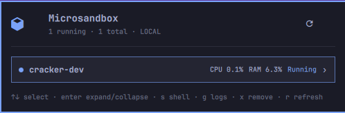
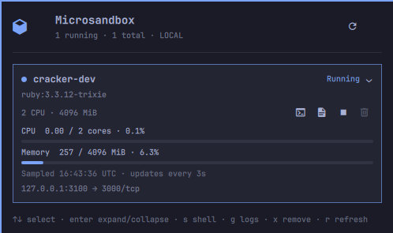

# Microsandbox Monitor

[](https://github.com/billybonks/omarchy-microsandobx-monitor/actions/workflows/ci.yml)

An independent community plugin by **billybonks**, licensed under [MIT](LICENSE). Not an official microsandbox or Omarchy product.

A native Omarchy top-bar widget and dropdown for your **existing local microsandbox installation**. This is not a TUI, WebView, or second desktop-shell process.

- Cube icon and running count in the bar; right-click to refresh.
- Dropdown with sandbox status, image, CPU/memory allocation, and published ports.
- Usage bars show CPU cores consumed versus allocated, and guest memory used versus its live limit.
- Start detached, stop gracefully, or remove a stopped sandbox after confirmation.
- Open the existing `msb ssh` or `msb logs -f` in an Omarchy terminal.
- Refresh every 3 seconds while open, every 15 seconds while closed; manual refresh at any time.
- Theme-aware appearance through Omarchy's own UI components.
- Each sandbox starts collapsed, showing CPU/RAM percentages in its header. Click the header or press Enter/Space to reveal details and controls; compact percentages disappear while expanded.
- Expansion is tracked by sandbox identity, so refreshes and reordered rows preserve it for the current panel session.
- Arrow keys/j/k select; Enter/Space expands/collapses; s opens a shell; g follows logs; x asks to remove; r refreshes; Escape closes. Start/stop uses its explicit button inside the expanded details.

## Screenshots

### Collapsed — CPU and memory usage at a glance



### Expanded — resource usage, allocations, ports, and controls



Screenshots supplied by the author; the visible sandbox name and loopback port are example workload details, not credentials. The expanded view is also provided as [`preview.png`](preview.png) for the marketplace.

## Architecture

`ui/DisclosureWidget.qml` and `ui/SandboxDisclosure.qml` implement the Omarchy interface. `ui/Service.qml` only launches the backend and assigns its JSON response to UI properties. There are no `.js` files, but QML still uses small JavaScript event handlers/bindings.

`microsandbox-panel` is a compiled Rust executable using the official **microsandbox 0.7.11 SDK**, pinned to match the installed `msb 0.7.11` runtime. Management does not scrape CLI output or generate shell scripts. Only interactive shell/log sessions use the existing CLI via direct argument arrays and `omarchy-launch-tui`.

The backend is short-lived: one invocation per refresh or user action. It explicitly selects `LocalBackend`, ignoring cloud backend selection from ambient API keys. It uses the SDK's existing home/config resolution, with no install/ensure/download calls. Runtime embedding/downloading and cloud features are disabled at compile time. Runtime, firmware, registry credentials, and sandbox state remain managed by microsandbox.

This does **not** turn microsandbox into a self-contained standalone runtime binary. An existing matching runtime and firmware are required. Building also downloads Rust crate dependencies from crates.io.

## Requirements

- **Linux with KVM** and Omarchy's Quickshell/native plugin API (developed against Omarchy 4.0.4). This plugin's backend currently targets Linux; macOS and Windows are not supported.
- An existing, working local **msb 0.7.11** installation, including firmware and KVM permissions.
- Rust stable, Cargo, Make, a C/C++ toolchain, CMake, and pkg-config to build the backend. On Arch/Omarchy these are normally provided by `base-devel`, `cmake`, and `pkgconf`; install missing tools yourself through your normal package manager. There is no automatic toolchain or runtime installer.
- The existing Omarchy terminal launcher for shell and log actions.

If your runtime is upgraded, review SDK compatibility and update the exact SDK dependency and lockfile together before rebuilding. The SDK accesses microsandbox's database, so avoid arbitrary SDK/runtime version mismatches.

## Build and install

**Source build required.** The repository intentionally does not contain a compiled backend. `omarchy plugin add <git-url> --enable` alone will not build it and is **not** a complete installation method for this plugin. There are no post-install hooks or silent downloads.

Clone the public repository outside your live plugin directory, review it, and build before enabling:

```sh
git clone https://github.com/billybonks/omarchy-microsandobx-monitor.git
cd omarchy-microsandobx-monitor
make test
make check
make install
# Explicit opt-in: adds the widget to your bar configuration.
make enable
```

`make install` builds with `--locked`, validates the source manifest, copies the executable, QML, and documentation into `~/.config/omarchy/plugins/billybonks.microsandbox-monitor/`, validates that folder, and rescans plugins. `make enable` is the separate step that adds the widget to the right section of the bar. No sudo, system service, keybinding, or desktop-shell restart is required. No sandbox is automatically created, started, stopped, or deleted during installation.

The helper is compiled for your current Linux architecture and links against the system libraries available on the build machine; this is not a promise of a portable static binary. Build on the target machine. The pinned SDK and its transitive dependencies are recorded in `Cargo.lock`.

The Makefile uses `~/.cargo/bin/cargo` by default. Override `CARGO=/path/to/cargo` when necessary.

```sh
omarchy bar move billybonks.microsandbox-monitor --section right
omarchy-shell shell summon billybonks.microsandbox-monitor '{}'
omarchy-shell shell hide billybonks.microsandbox-monitor
```

## Disable or remove

```sh
omarchy plugin disable billybonks.microsandbox-monitor
omarchy plugin remove billybonks.microsandbox-monitor
```

Removing the plugin does not remove the source checkout, `msb`, or any sandbox. The remove command deletes this plugin's installed directory and its bar entry; it does not reset the rest of your desktop configuration.

### Updates and early local builds

Review upstream changes before running `git pull --ff-only`, `make test`, `make check`, and `make install` again. There is no automatic updater. QML caching can occasionally require a later desktop-shell reload; do not restart the desktop shell just to update this plugin while a workload might depend on that shell's process lifetime.

The initial local prototype used the ID `local.microsandbox`. The publishing ID is **`billybonks.microsandbox-monitor`**. If migrating, disable the old widget explicitly before `make enable` to avoid duplicates. Installing this version does not automatically disable, remove, or rewrite that old installation.

## Safety boundaries

- The QML plugin runs unsandboxed inside Omarchy, as all native plugins do. The Rust helper runs with your user permissions. Neither is a new security boundary.
- Refresh only requests metadata. The SDK may initialize/open its normal database and perform its own bookkeeping; this is not a forensic read-only database client.
- No start, stop, or removal is triggered automatically.
- Actions carry both a name and stable sandbox identity. A removed/recreated sandbox cannot silently become the target of an old UI action; SDK receiver methods also check identity.
- Delete is only offered for a stopped/crashed sandbox, requires confirmation, and never implicitly force-stops it. Deletion removes managed sandbox data; back up important data first.
- Status has a 20-second deadline; actions have a 180-second deadline and a UI watchdog. A timeout does not guarantee rollback: refresh before retrying.
- No network listener, central daemon, telemetry, sudo, downloaded installer, or generated Bash.
- Starting a sandbox may cause normal SDK/runtime network activity. Its existing network/mount/secret configuration still applies.
- Full sandbox configuration, environment variables, and secrets are never sent to QML. Display fields are bounded and rendered as plain text.
- Lists are explicitly paginated and capped at 500 sandboxes. Counts describe the displayed subset if truncated.
- Shell and logs are trusted interactive terminal streams; they are not parsed or sanitized by this plugin. CLI launch uses a `--` option separator.
- Errors keep previous rows visible but disable actions and show that the state is stale.

## Resource usage

Usage comes from the SDK's shared-memory metrics reports; it does not execute monitoring commands inside the guest. A sample timestamp is shown, and samples marked stalled/exited are not presented as live usage. If metrics are disabled or unavailable, the allocation and management controls remain visible.

CPU is displayed in cores used / allocated cores, with the bar normalized to the allocation. The sampler reports 100% per busy core: 100% raw usage on a two-core sandbox is **50% of its allocation**, not 100%. These are runtime-accounted CPU readings, not an in-guest process breakdown.

Memory is guest memory in use / the live guest limit, not the host process's RSS. Live resizing is reflected by the metrics reports. Missing guest memory readings are labeled unavailable rather than presented as zero where distinguishable; the SDK represents some temporarily unavailable readings as zero during resize, so readings can briefly be inaccurate while the guest converges.

## Backend protocol

```sh
./target/release/microsandbox-panel status
./target/release/microsandbox-panel start NAME ID
./target/release/microsandbox-panel stop NAME ID
./target/release/microsandbox-panel remove NAME ID
./target/release/microsandbox-panel shell NAME ID
./target/release/microsandbox-panel logs NAME ID
```

Each invocation prints one bounded JSON object with `ok`, `error`, `sandboxes`, `runningCount`, and `truncated`, and exits nonzero on error. Identity values are opaque tokens obtained from `status`. The backend CLI has no confirmation prompt; confirmation is a UI responsibility.

## Publishing

See [the marketplace submission checklist and ready-to-copy listing details](docs/PUBLISHING.md). Marketplace approval is listing validation, **not a security audit**. No marketplace submission is made automatically by building or installing this project.

## License and dependencies

Plugin code and supplied preview images are covered by [MIT](LICENSE). The official microsandbox SDK is Apache-2.0; dependencies retain their own licenses. The project does not bundle the `msb` runtime, firmware, container images, Qt, or Omarchy. Cargo resolves the declared Rust dependencies using the committed lockfile; their build scripts run with the build user's permissions.

## Validation

`cargo test` covers request validation, command allowlisting, display sanitization, identity mismatch rejection, error response shape, usage normalization, missing readings, and progress-bar bounds. `qmllint` checks QML with the installed shell imports; dynamic Omarchy properties can produce static-analysis warnings. Live checks should inspect `qs log -p "$OMARCHY_PATH/shell" --tail 100` after enable/summon.

Integration testing against a user's existing sandboxes must be limited to listing and deliberately wrong-identity requests. Do not start, stop, or remove a real sandbox just to test the UI.
